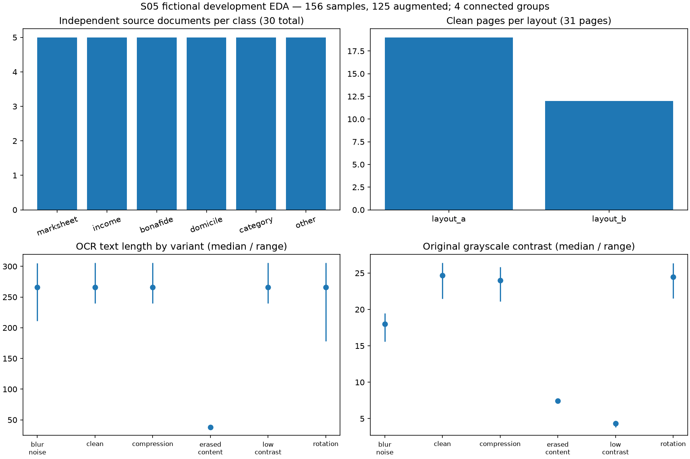
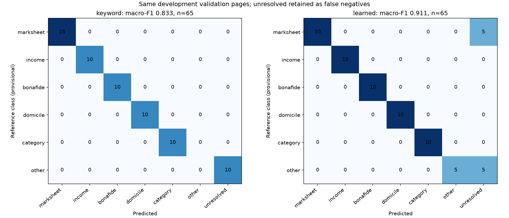

# S05 development classification and EDA

Historical S05 scope below concerns the pilot. S09 now supplies a separate frozen experiment/model and untouched reviewed test; see [the current protocol](EVALUATION_PROTOCOL.md). The S05 pilot/model/results are preserved unchanged.

This sprint adds a local learned classifier and a reproducible development experiment. All pilot records remain `development_only`; no final test exists or has been consumed. The generated references remain provisional. [Acceptance evidence](verification/S05.md), [EDA](verification/s05/eda.json), [paired predictions](verification/s05/predictions.json) and [metrics](verification/s05/evaluation.json) record actual outcomes.

## Dataset and grouping

The pilot contains 30 independent generated source documents, 31 clean pages, 125 augmented pages, five fictional applicants and two layouts. There are five sources per class; the marksheet class has six clean pages because one source has two pages. All six labels are present, with zero missing labels. Each of low contrast, rotation, blur/noise and compression has 31 derived pages; one additional income page has erased body content. EDA ran real branch-A OCR and original quality measurements on all 156 pages (155 input files). Every OCR status was `ok`; the erased page still has its watermark. Body-text removal identifies that case separately.

`connected_groups` joins records transitively by applicant ID, source document ID, source hash, input file and shared input-only bundle inventory. It reads no reference annotations or bundle expectations. In the mismatch bundle, applicant 4's documents occur alongside applicant 5's income document. Their complete source/variant families must therefore stay together, leaving **four connected components**.

| Development partition | Applicants | Connected groups | Sources | Clean pages | All pages | Layouts |
| --- | --- | --- | --- | --- | --- | --- |
| Train | 1, 3 | 2 | 12 | 12 | 61 | A |
| Validation | 4, 5 | 1 | 12 | 13 | 65 | A, B |
| Layout diagnostic | 2 | 1 | 6 | 6 | 30 | B |

Only the 12 clean training pages fit the vectorizer and classifier. Train augmentations remain assigned to train but are unused for fitting. Validation contains clean and degraded pages of the same sources; they are correlated, not 65 independent observations. All outer `SplitRecord.split` values are `development_only`; additive `development_partition` records the nested assignment. No early convenience partition has been relabelled final test. The split file binds the original manifest hash, seed 42 and `pilot-1.0`; its metadata binds every input-only bundle hash. Validation rejects missing/duplicate sample IDs, stale hashes, forged group IDs, protected roles and connected components crossing partitions.

For this pilot, the predeclared layout diagnostic fits only layout A and probes the exclusively layout-B component with fixed probability/margin thresholds 0.4/0.1 **before validation threshold selection**. Mixed-layout linked components supply validation. Both layouts occur in validation; the diagnostic assesses unseen layout relative to feature/model fitting, with untuned thresholds. It is a six-page synthetic diagnostic, not an independent generalization estimate. No diagnostic outcome feeds training or threshold selection. A fallback ordinary development assignment is available when these layout/component conditions cannot be met; insufficient group/class support is rejected instead of forcing stratification.



EDA JSON includes class/source counts, layouts, degradations, applicants/groups, OCR status/text and body length quartiles, and brightness/contrast/Laplacian variance/pixel dimension distributions for each variant. Quality measurements use ingested originals, including 300-DPI PDFs. They are descriptive heuristics, not probabilities. Format/resolution and applicant/layout correlations limit interpretation. No chart treats augmentation as independent source acquisition.

## Features, fitting and uncertainty

The scikit-learn `Pipeline` contains `TfidfVectorizer` and `LogisticRegression`. A pipeline keeps vectorizer fitting inside the training operation, as described in the official [pipeline documentation](https://scikit-learn.org/stable/modules/compose.html) and [leakage guidance](https://scikit-learn.org/stable/common_pitfalls.html#data-leakage). The verified installed version is scikit-learn 1.9.1.

Feature input is OCR text alone: NFC normalization, case folding, collapsed whitespace, common exact synthetic watermark removal, word unigrams/bigrams, `min_df=1`, sublinear term frequency. Filenames, paths, applicant/source/sample IDs, layout labels, quality measurements, annotations and target labels are never features. Visible names/body wording remain OCR text and can still encode synthetic/template correlations; stripping metadata cannot prove generalization. References are not opened by training or runtime. Manifest class labels serve only fitting/evaluation targets.

Logistic Regression uses fixed `C=4`, `max_iter=1000`, seed 42. With only two training groups, no reliable hyperparameter search or calibration is claimed. All preprocessing/OCR settings are fixed: A, English, OEM3, PSM3, timeout 20 seconds, PDF 300 DPI, default `dip-1.0`/`quality-1.0`. A remains the default; no per-page branch selection occurs.

Validation tries probabilities 0.3/0.4/0.5/0.6 crossed with margins 0.05/0.1/0.2. It maximizes six-label macro-F1, breaks ties by fewer wrong accepted classifications, then stricter probability and margin. Selected thresholds are **maximum class probability >=0.4**, **top-two margin >=0.2**. Vocabulary coverage >=0.1 and rejection of multiple literal title families are fixed guards, not validation-tuned settings. A body with no text is `unreadable`; page/input failures are `error`; insufficient vocabulary, score/margin or conflicting titles give `uncertain`. `other` is a learned label for the observed notice examples, never a catch-all for unknown documents. Scores are `model_probability`, explicitly uncalibrated.

## Actual paired results

Metrics use the same pages, fixed six labels and identical OCR for both classifiers. Unresolved predictions remain false negatives for their reference class. The confusion matrix has six target rows and seven prediction columns, including unresolved. Per-class zero divisions use zero; an empty dataset has null macro-F1/accuracy. No unresolved items are dropped to inflate accuracy.

| Partition | Pages | Keyword macro-F1 | Learned macro-F1 | Keyword / learned unresolved | Accuracy, both |
| --- | --- | --- | --- | --- | --- |
| Validation clean | 13 | 0.8333 | 0.9111 | 2 / 2 | 11/13 |
| Validation all variants | 65 | 0.8333 | 0.9111 | 10 / 10 | 55/65 |
| Untuned layout-B diagnostic, clean | 6 | 0.8333 | 0.8333 | 1 / 1 | 5/6 |

Each regular validation variant has the same ratios; five related views do not establish a robust improvement. There are zero wrong accepted classes for either method on this validation partition, with ten unresolved each. This is no claim about arbitrary unknown uploads or readiness accuracy.

| Class, validation all variants | Support | Keyword precision / recall / F1 | Learned precision / recall / F1 |
| --- | --- | --- | --- |
| marksheet | 15 | 1 / 1 / 1 | 1 / 0.667 / 0.800 |
| income_certificate | 10 | 1 / 1 / 1 | 1 / 1 / 1 |
| bonafide_certificate | 10 | 1 / 1 / 1 | 1 / 1 / 1 |
| domicile_certificate | 10 | 1 / 1 / 1 | 1 / 1 / 1 |
| category_certificate | 10 | 1 / 1 / 1 | 1 / 1 / 1 |
| other | 10 | 0 / 0 / 0 | 1 / 0.5 / 0.667 |



The learned model recognizes applicant 5's reading notice, while both abstain on applicant 4's club notice. The keyword baseline resolves the marksheet continuation; the page-level learned classifier abstains there. Training/evaluation here are page-level. Runtime concatenates every page in a document before classifying, preserving multipage evidence and explicit failure handling; these page scores do not measure document-level performance. Unknown-document recognition remains narrow and uncalibrated.

## Run and reload locally

Use the existing verified `.venv` from repository root; regenerate ignored pilot media with the S02 command if absent. Every split/output destination below must be new. Existing official split and outputs are preserved; choose new names when repeating.

```bash
.venv/bin/python scripts/make_splits.py --manifest data/manifests/pilot.jsonl --output data/manifests/my-development.splits.jsonl --seed 42
.venv/bin/python scripts/train_classifier.py --manifest data/manifests/pilot.jsonl --splits data/manifests/my-development.splits.jsonl --branch A --output artifacts/runs/my-classification
.venv/bin/python -m scholarready demo --classifier artifacts/runs/my-classification/model --output artifacts/runs/my-learned-demo
```

The recorded S05 model is at `artifacts/runs/s05-classification-final/model`. It contains `model.joblib` and `metadata.json`: class mapping, feature policy, training IDs/text/label hash, validation IDs/results, dataset/split/model hashes, seed, exact command, code snapshot, OCR/preprocessing settings and dependency versions. No annotation file is needed to load or use it. Model artifacts and full OCR/stage media are ignored; compact text/results/provenance/figures are versioned under `docs/verification/s05`. To regenerate, train from the preserved split into a new output directory. See [actual commands and hashes](verification/S05.md).

Loading checks the model SHA256, class mapping, threshold bounds and exact scikit-learn/NumPy/SciPy/joblib versions. `joblib` uses pickle semantics: use locally trusted project-generated artifacts; a hash in adjacent metadata is an integrity check, not proof of trust. This follows the official [model persistence guidance](https://scikit-learn.org/stable/model_persistence.html). Runtime rejects mismatched branch/OCR/PDF-DPI/preprocessing settings. CLI and offline evaluation call the same classifier; the future UI can call the same `analyze(..., classifier=...)`. Omitting `--classifier` keeps the keyword baseline.

An optional `--features <prior-run>/ocr_features.jsonl` avoids repeated OCR only after checking input hashes, OCR/preprocessing settings, OCR-related code and feature-file hash. The final S05 training used that cache after the original 156-page OCR run. Original run time was 102.18 seconds including OCR/EDA/training/figures; cached final run was 1.63 seconds. These modes have different timing scopes and are not a speedup benchmark. Both model weights and predictions agreed in the verification replay.

## Learning and joint review

TF-IDF gives more weight to informative words; Logistic Regression learns class weights from labelled training text. A large model score is not proof of correctness. Applicant/source grouping asks whether new related material has leaked into validation. Macro-F1 gives each of the six labels equal weight, which explains why recognizing some notices improves macro-F1 even while total accuracy stays unchanged.

Both students can inspect the two matrices, explain why 156 samples mean only 30 sources/four connected groups, trace the mismatch bundle connection, compare the page continuation failure with document aggregation, and explain why vocabulary is fit only on train. Suggested leads remain learning assignments; no student review or sign-off is claimed. S06 strengthens spatial extraction next; S09 owns expanded reviewed data, final splits/tuning and experiment freeze.
